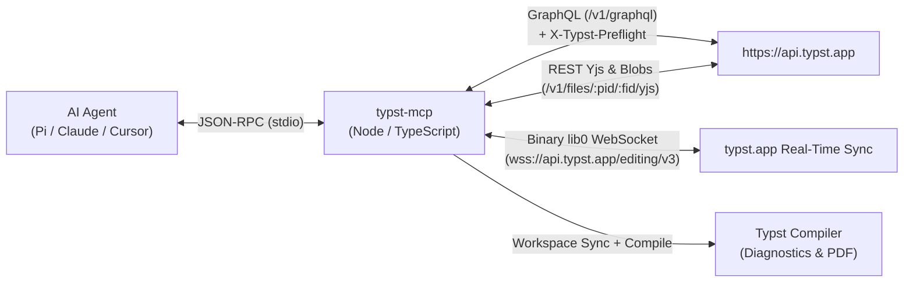

<div align="center">

# Typst Web MCP

**Model Context Protocol (MCP) server for [`https://typst.app`](https://typst.app) — cloud projects, Yjs CRDT editing, and Typst compiler diagnostics**

Install from npm as [`typst-mcp`](https://www.npmjs.com/package/typst-mcp). Source repo: [`typst-web-mcp`](https://github.com/caphefalumi/typst-web-mcp).

[](https://www.npmjs.com/package/typst-mcp)
[](https://www.npmjs.com/package/typst-mcp)
[](./LICENSE)
[](https://github.com/caphefalumi/typst-web-mcp/actions/workflows/npm-publish.yml)
[](https://bun.sh)
[](https://www.typescriptlang.org/)
[](https://modelcontextprotocol.io)
[](./docs/PROTOCOL.md)
[-2ea44f?style=flat-square)](./test/typst-mcp.test.ts)

</div>

---

## Overview

`typst-web-mcp` connects AI coding and writing agents directly to collaborative [**typst.app**](https://typst.app) cloud projects. Instead of relying on brittle browser DOM scraping, it implements the native `typst.app` client protocol:

- **Native Yjs CRDT Text Sync:** Decodes and mutates multiplayer `Y.Doc` (`doc.getText("text")`) state vectors so surgical edits preserve collaborator cursors and version history.
- **Binary `/editing/v3` WebSocket Wire Protocol:** Encodes and decodes `lib0` variable-length binary frames (`Subscribe`, `TextUpdate`, `Pong`, `Refresh`, `Presence`, `Cursor`, `Leave`) with REST `/v1/files/:projectId/:fileId/yjs` persistence.
- **GraphQL & REST Project Management:** Full project CRUD, file tree inspection, rename/move, delete, and binary figure/asset uploads (`PNG`, `JPG`, `SVG`, `PDF`, fonts).
- **Direct Authentication + Fallback:** Authenticates via `GET /v1/to-signin` + `POST /v1/auth/signin` (`__Http-typst-session`), with persistent session caching and automatic cookie/Playwright fallback on challenge.
- **Compiler Diagnostics, Preview Screenshots & PDF Export:** Synchronizes cloud Yjs text and binary assets into an isolated workspace and runs the Typst compiler to return structured line/column diagnostics, high-DPI PNG preview screenshots (`typst_capture_screenshot`), and compiled PDFs (`typst_export_pdf`).

---

## Architecture



See [`docs/PROTOCOL.md`](./docs/PROTOCOL.md) for the complete reverse-engineered protocol specification.

---

## MCP Tools (16 Tools)

| Category | Tool Name | Description |
|:---|:---|:---|
| **Auth** | `typst_auth_login` | Authenticate with `https://typst.app` via email/password (`POST /v1/auth/signin`) or `__Http-typst-session` cookie, with browser fallback. |
| **Auth** | `typst_auth_status` | Check active authentication state, login method, and stored session cookies. |
| **Projects** | `typst_list_projects` | List all owned and shared/external projects in the user's `typst.app` dashboard (`DashboardContent`). |
| **Projects** | `typst_get_project` | Retrieve full project metadata, access permissions, pinned compiler version, and file tree (`ProjectFiles`). |
| **Projects** | `typst_create_project` | Create a new `typst.app` cloud project with initial `.typ`/`.bib` files and pinned compiler version. |
| **Projects** | `typst_delete_project` | Permanently delete a `typst.app` project by ID (`DeleteProjectMutation`). |
| **Files & CRDT** | `typst_list_files` | List all multiplayer Yjs text files and binary asset blobs in a project. |
| **Files & CRDT** | `typst_read_file` | Read any project file — decodes binary Yjs CRDT state (`doc.getText("text")`) into UTF-8 text or base64 for binary assets. |
| **Files & CRDT** | `typst_write_file` | Create or overwrite a `.typ`/`.bib`/`.toml` file, syncing Yjs state diffs over `/editing/v3` WebSocket and REST. |
| **Files & CRDT** | `typst_edit_file` | Apply non-overlapping surgical `oldText -> newText` replacements directly to the `Y.Text("text")` CRDT. |
| **Assets & Tree** | `typst_upload_asset` | Upload or replace binary assets (`PNG`, `JPG`, `SVG`, `PDF`, fonts) from a local path or base64 payload. |
| **Assets & Tree** | `typst_rename_file` | Rename or move a file inside a `typst.app` project (`UpdatesFileMutation`). |
| **Assets & Tree** | `typst_delete_file` | Delete a file or binary asset from a project (`DeleteFilesMutation`). |
| **Compiler** | `typst_get_diagnostics` | Sync all cloud files and run `typst compile` to return structured errors, warnings, line/column spans, and hints. |
| **Compiler** | `typst_export_pdf` | Sync all cloud text & binary assets, compile the project to PDF, and save to `outputPath`. |
| **Preview** | `typst_capture_screenshot` | Capture high-DPI PNG preview screenshots (`mode="pages"` renders compiled PNG pages; `mode="browser"` screenshots the live `typst.app` web UI). |

---

## Quick Start

### Prerequisites

- [**Node.js**](https://nodejs.org/) `>= 18` (for `npx` install) or [**Bun**](https://bun.sh) `>= 1.2` (for local development)
- [**Typst CLI**](https://github.com/typst/typst) (`typst` on `PATH` for `typst_get_diagnostics` and `typst_export_pdf`)

### Installation

**Recommended — no clone, no global install:**

```bash
npx -y typst-mcp
```

Runs the published [`typst-mcp`](https://www.npmjs.com/package/typst-mcp) package (Node `>= 18`). Use the same command in MCP config below. `-y` skips the npx install prompt.

**From source (development):**

```bash
git clone https://github.com/caphefalumi/typst-web-mcp.git
cd typst-web-mcp
bun install
bun run dev
```

### MCP Client Configuration

Add `typst-mcp` to your MCP client configuration (`.pi/agent/mcp-adapter.json`, `claude_desktop_config.json`, or `.cursor/mcp.json`):

```json
{
  "mcpServers": {
    "typst-mcp": {
      "command": "npx",
      "args": ["-y", "typst-mcp"],
      "env": {
        "TYPST_EMAIL": "your-email@example.com",
        "TYPST_PASSWORD": "your-password"
      }
    }
  }
}
```

> **Session Persistence:** Once authenticated via `typst_auth_login` (or environment variables), the `__Http-typst-session` cookie is cached locally at `~/.pi/agent/typst-mcp-session.json` so subsequent tool calls authenticate automatically without re-signing in.

---

## Development & Verification

```bash
# Compile publishable output to dist/
bun run build

# Typecheck with strict TypeScript
bun run typecheck

# Run full unit, mock server, and live api.typst.app protocol test suite
bun test
```

### Publishing to npm

Same flow as [Canvas-CLI](https://github.com/caphefalumi/Canvas-CLI):

1. Bump `version` in `package.json` (must not match a version already on npm).
2. Commit, push, and create a GitHub **Release** for that tag — or run **Actions → Publish → Run workflow** (`workflow_dispatch`).

[`.github/workflows/npm-publish.yml`](./.github/workflows/npm-publish.yml) runs on the `npm-publish` GitHub environment: `bun ci`, `bun run build`, then `npm publish --access public` via [npm trusted publishing](https://docs.npmjs.com/trusted-publishers) (OIDC). The publish step clears `NODE_AUTH_TOKEN` so the CLI uses GitHub OIDC instead of a stale token from `setup-node`.

**Trusted publisher (maintainers):** package [`typst-mcp`](https://www.npmjs.com/package/typst-mcp) → Settings → Trusted publishing → GitHub Actions — user/org `caphefalumi`, repo `typst-web-mcp`, workflow file `npm-publish.yml`, environment `npm-publish`, allow **npm publish**.

### Project Structure

```text
typst-web-mcp/
├── docs/
│   └── PROTOCOL.md              # Reverse-engineered typst.app REST, GraphQL, Yjs & WS v3 spec
├── src/
│   ├── protocol/
│   │   ├── ws-codec.ts          # Binary lib0 /editing/v3 WebSocket encoder & decoder
│   │   ├── yjs-doc.ts           # Yjs CRDT text decoding, replacement & surgical patching
│   │   └── graphql.ts           # GraphQL queries, mutations, fragments & types
│   ├── client/
│   │   ├── auth.ts              # Direct /v1/auth/signin login, cookie jar & Playwright fallback
│   │   ├── compiler.ts          # Typst binary resolver, diagnostic parser, PDF & PNG preview compiler
│   │   ├── errors.ts            # Structured TypstLoadError & error formatting helpers
│   │   └── typst-client.ts      # TypstCloudClient (REST, GraphQL, WebSocket v3, Compiler facade)
│   ├── tools/
│   │   └── definitions.ts       # MCP JSON Schema definitions for all 16 tools
│   └── index.ts                 # MCP stdio server entrypoint (dev); npm bin runs dist/index.js
├── test/
│   └── typst-mcp.test.ts        # 7 test suites (57 assertions) covering codecs, CRDTs & E2E
├── LICENSE                      # MIT License
└── package.json
```

---

## License

Released under the [MIT License](./LICENSE). Copyright (c) 2026 Dang Duy Toan (`caphefalumi`).
